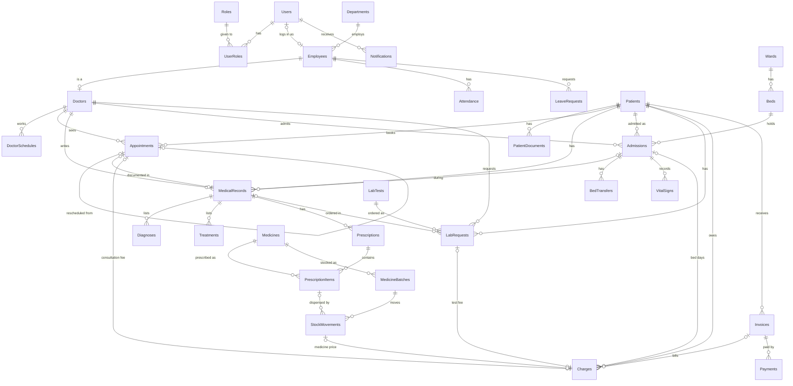

# Database

The HMS stores everything in one **PostgreSQL** database (named `hms` in development). Tables are defined in C# and created by **Entity Framework Core migrations**:

- `backend/Hms.Api/Entities/` — one C# class per table (an *entity*).
- `backend/Hms.Api/Data/AppDbContext.cs` — the list of tables (`DbSet`s), keys, indexes, unique rules and check constraints.
- `backend/Hms.Api/Migrations/` — generated SQL steps that build the tables, applied with `dotnet ef database update`.

This page describes the database **as built**. The original design with every column is in the project plan's ER diagram; where the two differ, this page and the code are correct.

## General rules

| Rule | How |
| --- | --- |
| Date-times are UTC | Stored as `timestamp with time zone`. The app shows them in hospital time (Asia/Colombo). Date-only values (date of birth, leave dates, expiry) are `date`. |
| Money is exact | Every `decimal` is `numeric(12,2)`. Never floating point. |
| Enums are text | Status and type columns store names such as `"Scheduled"` (max 30 characters), so the data reads well in pgAdmin. |
| Nothing is hard-deleted | Every foreign key is `ON DELETE RESTRICT`. Patients, staff, medicines, beds and logins are deactivated instead of deleted. |
| Readable numbers | PostgreSQL sequences give `P-000001` (patients), `EMP-0001` (employees), `ADM-000001` (admissions), `LAB-000001` (lab requests), `INV-000001` (invoices), `RCP-000001` (receipts). |
| `...ByUserId` columns | Point to `Users` (who created, recorded or approved something). |

## Tables

36 tables: 7 for logins (ASP.NET Core Identity, renamed from the default `AspNet...` names) and 29 for the hospital.

| Area | Tables |
| --- | --- |
| Logins and roles | `Users`, `Roles`, `UserRoles`, `UserClaims`, `UserLogins`, `UserTokens`, `RoleClaims` |
| Staff and doctors | `Departments`, `Employees`, `Doctors`, `DoctorSchedules`, `Attendance`, `LeaveRequests` |
| Patients and appointments | `Patients`, `PatientDocuments`, `Appointments` |
| Medical records | `MedicalRecords`, `Diagnoses`, `Treatments`, `Prescriptions`, `PrescriptionItems` |
| Inpatients | `Wards`, `Beds`, `Admissions`, `BedTransfers`, `VitalSigns` |
| Laboratory | `LabTests`, `LabRequests` |
| Pharmacy | `Medicines`, `MedicineBatches`, `StockMovements` |
| Billing | `Charges`, `Invoices`, `Payments` |
| System | `AuditLogs`, `Notifications` |

## Entity relationship diagram

Relationships only (columns are in the table descriptions below). `||--o{` means one to zero-or-many, `|o--o|` zero-or-one to zero-or-one.

## Table descriptions

### Logins and staff

| Table | Key columns | Rules |
| --- | --- | --- |
| `Users` | Identity columns (`UserName`, `PasswordHash`, `LockoutEnd`, `AccessFailedCount`, `SecurityStamp`) plus `IsActive`, `MustChangePassword` | User name unique. Passwords are stored only as Identity hashes. |
| `Roles`, `UserRoles` | The 7 roles; which user has which | Seeded at start-up. |
| `Departments` | `Name`, `Description`, `IsActive`, `IsClinical` | Name unique. *Administration* is the built-in non-clinical department. |
| `Employees` | `EmployeeNumber`, names, `JobTitle`, `Phone`, `Email`, `HireDate`, `IsActive`, `DepartmentId`, `UserId` | Number unique. Optional link to one login. |
| `Doctors` | `EmployeeId`, `Specialization`, `LicenseNumber`, `ConsultationFee`, `SlotMinutes` | One per employee. Licence unique. Fee ≥ 0, slot > 0. |
| `DoctorSchedules` | `DoctorId`, `DayOfWeek`, `StartTime`, `EndTime` | End after start. No two blocks start at the same time on the same day. |
| `Attendance` | `EmployeeId`, `Date`, `Status`, `CheckIn`, `CheckOut` | One row per employee per day. |
| `LeaveRequests` | `EmployeeId`, `LeaveType`, `StartDate`, `EndDate`, `Reason`, `Status`, reviewer and note | End on or after start. |

### Patients and appointments

| Table | Key columns | Rules |
| --- | --- | --- |
| `Patients` | `PatientNumber`, names, `DateOfBirth`, `Gender`, `NationalId`, `Phone`, `Email`, `Address`, `BloodGroup`, `Allergies`, emergency contact | Patient number unique; national ID unique when given. Indexed on name and phone for search. |
| `PatientDocuments` | `PatientId`, `FileName`, `StoredFileName`, `ContentType`, `SizeBytes`, `Description` | The file itself is on disk under a random stored name (unique). Size 1 byte to 5 MB. |
| `Appointments` | `PatientId`, `DoctorId`, `StartTime`, `EndTime`, `Status`, `Reason`, `CancellationReason`, `RescheduledFromId` | **A doctor cannot have two active appointments at the same start time** (unique index that ignores Cancelled and Rescheduled). End after start. |

### Medical records

| Table | Key columns | Rules |
| --- | --- | --- |
| `MedicalRecords` | `PatientId`, `DoctorId`, `AppointmentId`, `AdmissionId`, `VisitDate`, `ChiefComplaint`, `ClinicalNotes` | One visit. |
| `Diagnoses` | `MedicalRecordId`, `Code`, `Description`, `IsPrimary` | |
| `Treatments` | `MedicalRecordId`, `Description`, `PerformedAt` | |
| `Prescriptions` | `MedicalRecordId`, `PrescribedAt`, `Status` | Pending, PartiallyDispensed, Dispensed, Cancelled. |
| `PrescriptionItems` | `MedicineId`, `Dosage`, `Frequency`, `DurationDays`, `Quantity`, `QuantityDispensed`, `Instructions` | Quantity and duration > 0; dispensed between 0 and quantity. |

### Inpatients

| Table | Key columns | Rules |
| --- | --- | --- |
| `Wards` | `Name`, `WardType`, `DailyCharge` | Name unique. Charge ≥ 0. |
| `Beds` | `WardId`, `BedNumber`, `IsActive` | Bed number unique within a ward. |
| `Admissions` | `AdmissionNumber`, `PatientId`, `BedId`, `AdmittingDoctorId`, `AdmittedAt`, `DischargedAt`, `Status`, `AdmissionReason`, `DischargeSummary` | **One open admission per bed and one per patient** (unique indexes where `DischargedAt` is empty). |
| `BedTransfers` | `AdmissionId`, `FromBedId`, `ToBedId`, `TransferredAt`, `Reason` | From and to beds differ. |
| `VitalSigns` | `AdmissionId`, `RecordedAt`, temperature, pulse, blood pressure, respiratory rate, oxygen saturation, `Notes` | |

### Laboratory and pharmacy

| Table | Key columns | Rules |
| --- | --- | --- |
| `LabTests` | `Code`, `Name`, `Price`, `Unit`, `ReferenceRange`, `IsActive` | Code unique. Price ≥ 0. |
| `LabRequests` | `RequestNumber`, `PatientId`, `LabTestId`, `RequestedByDoctorId`, `MedicalRecordId`, `Status`, `SampleId`, result columns | Request number and sample ID unique. |
| `Medicines` | `Name`, `GenericName`, `Form`, `Strength`, `UnitPrice`, `ReorderLevel`, `IsActive` | Name + strength + form unique. |
| `MedicineBatches` | `MedicineId`, `BatchNumber`, `ExpiryDate`, `QuantityOnHand`, `CostPrice` | Batch number unique per medicine. **Quantity can never go below 0.** |
| `StockMovements` | `MedicineBatchId`, `MovementType`, `Quantity`, `PrescriptionItemId`, `Reason` | StockIn, Dispense, Adjustment, Expired. Quantity ≠ 0. The full stock history. |

### Billing

| Table | Key columns | Rules |
| --- | --- | --- |
| `Charges` | `PatientId`, `ChargeType`, `Description`, `Quantity`, `UnitPrice`, `Amount`, the source, `InvoiceId` | **Exactly one source** is set: appointment, lab request, stock movement or admission. An appointment, lab request or stock movement can be charged only once. Not yet invoiced while `InvoiceId` is empty. |
| `Invoices` | `InvoiceNumber`, `PatientId`, `IssuedAt`, `Status`, `Subtotal`, `Discount`, `Total`, `AmountPaid` | Number unique. Discount and total ≥ 0. Draft, Issued, PartiallyPaid, Paid, Cancelled. |
| `Payments` | `ReceiptNumber`, `InvoiceId`, `Amount`, `Method`, `ReferenceNumber`, `PaidAt` | Receipt number unique. Amount > 0. |

### System

| Table | Key columns | Rules |
| --- | --- | --- |
| `AuditLogs` | `Timestamp`, `UserId`, `UserName`, `Action`, `EntityName`, `EntityId`, `Changes` (JSON), `IpAddress` | Rows are only ever added. Never contains passwords. |
| `Notifications` | `UserId`, `Title`, `Message`, `Link`, `CreatedAt`, `ReadAt` | Each row belongs to one login. |

## Migrations

| Migration | Adds |
| --- | --- |
| `InitialCreate` | All 35 tables of the original design (logins, staff, patients, appointments, medical records, inpatients, laboratory, pharmacy, billing, audit log) |
| `AddBilling` | Invoice and receipt number sequences; "charged only once" unique indexes on `Charges`; index on `Payments.PaidAt` |
| `AddStaffManagement` | Review and request columns on `LeaveRequests` |
| `AddMustChangePassword` | `Users.MustChangePassword` |
| `AddDepartmentIsClinical` | `Departments.IsClinical` |
| `AddNotifications` | `Notifications` |

**Changing the database:** edit the entity and `AppDbContext.cs`, then in `backend\Hms.Api` run `dotnet ef migrations add DescriptiveName`, read the generated `Up` method (it must not drop anything you did not mean to), then `dotnet ef database update`. Commit the migration files with the code change.

## Starter data

Added at API start-up when missing (never overwritten): the 7 roles, the first administrator, the starter departments, a starter lab test catalogue, and a starter list of medicines with demo prices. All other data is entered through the app, and must be fictitious.
