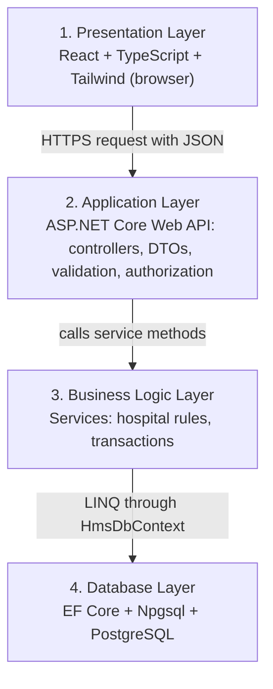

# HMS Project Plan and Requirements

Last updated: 18 November 2026. Source of requirements: Hospital_system.pdf.

## 1. Project summary

We are building a web-based Hospital Management System (HMS) that centralises patient records, appointments, medical records, laboratory, pharmacy, billing, admissions, staff and reports in one secure application, used by seven staff roles. Everything below comes from Hospital\_system.pdf (10 pages, 12 sections) unless it is labelled **Proposed** or **From your brief**.

**What the PDF asks for, at a glance**

- **10 functional modules** (section 3, pages 3 to 5): User Management, Patient, Doctor, Appointment, Electronic Medical Records, Laboratory, Pharmacy, Billing, Staff, Reports. Inpatient and Outpatient Management is named only in the Scope (section 1.2, page 2) and has no detail of its own.
- **7 user roles** (section 2, page 2): Administrator, Doctor, Nurse, Receptionist, Laboratory Staff, Pharmacist, Accountant. Patients are not users; a Patient Portal is a future enhancement.
- **Non-functional requirements** (section 4, page 5): performance, security (secure login, password protection, RBAC, audit logs, automatic session timeout), reliability (daily backup, high availability, recovery) and usability (friendly, responsive, easy navigation).
- **A four-layer architecture** (section 5, page 6): Presentation, Application, Business Logic, Database.
- **13 database modules** (section 6, page 6): Users, Roles, Patients, Doctors, Departments, Appointments, Admissions, Medical Records, Laboratory Tests, Pharmacy, Billing, Payments, Employees.
- **5 specified screens** (section 7, page 7): Login, Dashboard, Patient, Appointment (with calendar view), Billing (with print receipt).
- **Hardware and software constraints** (sections 8 and 9, page 8): our stack (.NET + PostgreSQL, used from Chrome, Edge or Firefox on Windows 10/11) is one of the allowed options.
- **Backup and recovery** (section 10, pages 8 to 9): automatic daily backup, weekly full backup, a disaster recovery plan, an audit trail.
- **Out of scope for now** (section 12, page 9): mobile app, patient portal, SMS and email notifications, telemedicine, insurance, AI decision support, biometric login, cloud deployment.

Section 11 (Benefits) lists goals, not testable requirements. They are tracked as goals in the matrix so nothing is dropped.

## 2. Requirement traceability matrix

Every bullet in the PDF has one row: 132 PDF rows plus 5 from your brief, every status is Not started today, and we update the Status column as each phase finishes. Priority key: **Must** = stated in the PDF as a requirement; **Constraint** = an environment rule we must respect; **Goal** = a benefit (section 11) that is not directly testable; **Future** = section 12, not built now unless you approve; **Proposed** = not in the PDF, my recommendation (see section 3 of this doc).

### 2.1 User roles (section 2, page 2)

| ID | PDF ref | Requirement | Module | Priority | Status | Acceptance criteria |
| --- | --- | --- | --- | --- | --- | --- |
| ROLE-01 | 2, p2 | Administrator role | User Management | Must | Not started | Admin can sign in and reach admin-only pages; other roles get 403 |
| ROLE-02 | 2, p2 | Doctor role | User Management | Must | Not started | Doctor reaches clinical pages (EMR, own appointments) only |
| ROLE-03 | 2, p2 | Nurse role | User Management | Must | Not started | Nurse permissions match the approved permission table (doc section 4) |
| ROLE-04 | 2, p2 | Receptionist role | User Management | Must | Not started | Receptionist can register patients and book appointments, cannot see diagnoses |
| ROLE-05 | 2, p2 | Laboratory Staff role | User Management | Must | Not started | Lab staff can process lab requests and enter results only |
| ROLE-06 | 2, p2 | Pharmacist role | User Management | Must | Not started | Pharmacist can manage stock and dispense prescriptions only |
| ROLE-07 | 2, p2 | Accountant role | User Management | Must | Not started | Accountant can manage invoices, payments and revenue reports only |

### 2.2 Functional requirements (section 3, pages 3 to 5)

| ID | PDF ref | Requirement | Module | Priority | Status | Acceptance criteria |
| --- | --- | --- | --- | --- | --- | --- |
| FR-UM-01 | 3.1, p3 | Login | User Management | Must | Not started | Valid username and password signs in; wrong password shows a generic error; repeated failures lock the account temporarily |
| FR-UM-02 | 3.1, p3 | Logout | User Management | Must | Not started | Logout ends the session; protected API calls then return 401 |
| FR-UM-03 | 3.1, p3 | Password management | User Management | Must | Not started | User can change own password; admin can reset a user's password; password policy enforced |
| FR-UM-04 | 3.1, p3 | User roles | User Management | Must | Not started | Admin can create users and assign one or more of the 7 roles |
| FR-UM-05 | 3.1, p3 | Access control | User Management | Must | Not started | Every API endpoint checks role on the server; tests prove each role is refused outside its permissions |
| FR-PM-01 | 3.2, p3 | Register patient | Patient | Must | Not started | Required fields validated; a unique patient number is generated; record saved |
| FR-PM-02 | 3.2, p3 | Update patient information | Patient | Must | Not started | Authorised role edits details; change is audit-logged |
| FR-PM-03 | 3.2, p3 | Search patient | Patient | Must | Not started | Search by name, patient number or phone returns paged results |
| FR-PM-04 | 3.2, p3 | View medical history | Patient / EMR | Must | Not started | Clinical roles see diagnoses, prescriptions, lab results and admissions in date order |
| FR-PM-05 | 3.2, p3 | Upload documents | Patient | Must | Not started | PDF or image up to an agreed size limit uploads, lists and downloads; other file types are rejected |
| FR-DM-01 | 3.3, p3 | Add doctor | Doctor | Must | Not started | Admin creates a doctor with specialisation, licence number and login account |
| FR-DM-02 | 3.3, p3 | Update doctor details | Doctor | Must | Not started | Admin edits doctor details; change is audit-logged |
| FR-DM-03 | 3.3, p3 | Department assignment | Doctor | Must | Not started | Doctor is linked to one department; doctors can be filtered by department |
| FR-DM-04 | 3.3, p3 | Schedule management | Doctor | Must | Not started | Weekly working hours and slot length can be set; booking uses them |
| FR-AP-01 | 3.4, p3 | Book appointment | Appointment | Must | Not started | Booking inside the doctor's schedule succeeds; overlapping booking is refused |
| FR-AP-02 | 3.4, p3 | Cancel appointment | Appointment | Must | Not started | Status becomes Cancelled with a reason; slot becomes free |
| FR-AP-03 | 3.4, p3 | Reschedule appointment | Appointment | Must | Not started | New time is validated against schedule and overlaps; history kept |
| FR-AP-04 | 3.4, p3 | Appointment status tracking | Appointment | Must | Not started | Status moves only along allowed steps (Scheduled, Checked in, Completed, Cancelled, No-show) |
| FR-EMR-01 | 3.5, p4 | Patient diagnosis | EMR | Must | Not started | Doctor records a diagnosis linked to a visit; non-clinical roles cannot read it |
| FR-EMR-02 | 3.5, p4 | Prescriptions | EMR | Must | Not started | Doctor prescribes medicines with dose, frequency and duration; pharmacy can see it |
| FR-EMR-03 | 3.5, p4 | Treatment history | EMR | Must | Not started | Treatments and notes listed per patient in date order |
| FR-EMR-04 | 3.5, p4 | Medical reports | EMR | Must | Not started | A printable medical report for a visit or admission can be produced |
| FR-LAB-01 | 3.6, p4 | Test requests | Laboratory | Must | Not started | Doctor requests tests from a test catalogue; request appears in the lab queue |
| FR-LAB-02 | 3.6, p4 | Sample collection | Laboratory | Must | Not started | Lab staff record collection time and sample ID; status becomes Sample collected |
| FR-LAB-03 | 3.6, p4 | Result entry | Laboratory | Must | Not started | Lab staff enter results; status becomes Completed; doctor can view them |
| FR-LAB-04 | 3.6, p4 | Report generation | Laboratory | Must | Not started | Printable lab report with patient, test, result and reference range |
| FR-PH-01 | 3.7, p4 | Medicine inventory | Pharmacy | Must | Not started | Medicines with batches, quantity and expiry can be added and listed |
| FR-PH-02 | 3.7, p4 | Prescription processing | Pharmacy | Must | Not started | Pharmacist dispenses a prescription; stock decreases in one transaction |
| FR-PH-03 | 3.7, p4 | Stock management | Pharmacy | Must | Not started | Stock in and adjustments recorded; stock can never go below zero |
| FR-PH-04 | 3.7, p4 | Expiry monitoring | Pharmacy | Must | Not started | Batches expiring within the agreed window are listed and flagged; expired stock cannot be dispensed |
| FR-BL-01 | 3.8, p4 | Consultation charges | Billing | Must | Not started | Completed appointment adds the doctor's consultation fee to the patient's bill |
| FR-BL-02 | 3.8, p4 | Laboratory charges | Billing | Must | Not started | Completed lab test adds its catalogue price to the bill |
| FR-BL-03 | 3.8, p4 | Pharmacy charges | Billing | Must | Not started | Dispensed medicines add their price to the bill |
| FR-BL-04 | 3.8, p4 | Admission charges | Billing | Must | Not started | Bed charge per day is added at discharge |
| FR-BL-05 | 3.8, p4 | Invoice generation | Billing | Must | Not started | Invoice with unique number, line items, totals; totals match line items |
| FR-BL-06 | 3.8, p4 | Payment recording | Billing | Must | Not started | Full or part payment recorded with method; balance and status update |
| FR-IO-01 | 1.2, p2 | Inpatient management | Inpatient / Outpatient | Must (scope unclear) | Not started | Proposed: admit, assign ward and bed, transfer, discharge (needs your approval, see doc section 3) |
| FR-IO-02 | 1.2, p2 | Outpatient management | Inpatient / Outpatient | Must (scope unclear) | Not started | Proposed: an outpatient visit is an appointment that is checked in and completed by a doctor |
| FR-ST-01 | 3.9, p4 | Employee registration | Staff | Must | Not started | Admin registers an employee with job role and contact details |
| FR-ST-02 | 3.9, p4 | Attendance | Staff | Must | Not started | Daily attendance (present, absent, late) recorded and viewable per employee |
| FR-ST-03 | 3.9, p5 | Department assignment | Staff | Must | Not started | Employee linked to a department |
| FR-ST-04 | 3.9, p5 | Leave records | Staff | Must | Not started | Leave requested, approved or rejected, and listed per employee |
| FR-RP-01 | 3.10, p5 | Patient reports | Reports | Must | Not started | Registrations by date range; exportable or printable |
| FR-RP-02 | 3.10, p5 | Appointment reports | Reports | Must | Not started | Appointments by doctor, status and date range |
| FR-RP-03 | 3.10, p5 | Revenue reports | Reports | Must | Not started | Revenue by source and date range; totals match payments |
| FR-RP-04 | 3.10, p5 | Pharmacy reports | Reports | Must | Not started | Stock levels, low stock, near-expiry, dispensed items |
| FR-RP-05 | 3.10, p5 | Laboratory reports | Reports | Must | Not started | Tests by type, status and date range |
| FR-RP-06 | 3.10, p5 | Staff reports | Reports | Must | Not started | Attendance and leave by employee and month |

### 2.3 Non-functional requirements (section 4, page 5)

| ID | PDF ref | Requirement | Module | Priority | Status | Acceptance criteria |
| --- | --- | --- | --- | --- | --- | --- |
| NFR-PERF-01 | 4, p5 | Supports multiple concurrent users | Whole system | Must | Not started | Proposed target: 20 simulated users with no errors |
| NFR-PERF-02 | 4, p5 | Fast response time | Whole system | Must | Not started | Proposed target: common API calls under 1 second at the 95th percentile on the demo server |
| NFR-PERF-03 | 4, p5 | Optimised database performance | Database | Must | Not started | Indexes on search and foreign key columns; lists are paged |
| NFR-SEC-01 | 4, p5 | Secure login | User Management | Must | Not started | HTTPS only; lockout after repeated failures; HttpOnly secure cookie |
| NFR-SEC-02 | 4, p5 | Password encryption | User Management | Must | Not started | Passwords stored only as ASP.NET Core Identity hashes (see doc section 3, item C3) |
| NFR-SEC-03 | 4, p5 | Role-based access control | Whole system | Must | Not started | Same as FR-UM-05, plus UI hides what a role cannot use |
| NFR-SEC-04 | 4, p5 | Audit logs | Audit | Must | Not started | Create, update, delete and login events stored with user, time and entity; admin can view them |
| NFR-SEC-05 | 4, p5 | Automatic session timeout | User Management | Must | Not started | Idle session ends after the agreed time (proposed 20 minutes) and user returns to login |
| NFR-REL-01 | 4, p5 | Daily database backup | Operations | Must | Not started | Automated daily backup runs and a restore has been tested |
| NFR-REL-02 | 4, p5 | High availability | Operations | Must (limited in demo) | Not started | Health check endpoint; documented limits of the demo hosting |
| NFR-REL-03 | 4, p5 | Data recovery support | Operations | Must | Not started | Written restore procedure tested on a copy of the database |
| NFR-USA-01 | 4, p5 | User-friendly interface | Frontend | Must | Not started | Consistent layout, clear labels, validation messages next to fields |
| NFR-USA-02 | 4, p5 | Responsive design | Frontend | Must | Not started | Usable at 375 px, 768 px and 1280 px widths |
| NFR-USA-03 | 4, p5 | Easy navigation | Frontend | Must | Not started | Sidebar shows only the modules the role can use; any screen reachable in 3 clicks |

### 2.4 Architecture and database (sections 5 and 6, page 6)

| ID | PDF ref | Requirement | Module | Priority | Status | Acceptance criteria |
| --- | --- | --- | --- | --- | --- | --- |
| ARCH-01 | 5, p6 | Four layers: Presentation, Application, Business Logic, Database | Whole system | Must | Not started | Architecture doc maps each layer to code folders; controllers hold no business rules |
| DB-01 | 6, p6 | Users | Database | Must | Not started | Table exists via migration with constraints |
| DB-02 | 6, p6 | Roles | Database | Must | Not started | Table exists; 7 roles seeded |
| DB-03 | 6, p6 | Patients | Database | Must | Not started | Table exists; patient number unique |
| DB-04 | 6, p6 | Doctors | Database | Must | Not started | Table exists; linked to department and user |
| DB-05 | 6, p6 | Departments | Database | Must | Not started | Table exists; name unique |
| DB-06 | 6, p6 | Appointments | Database | Must | Not started | Table exists; foreign keys to patient and doctor |
| DB-07 | 6, p6 | Admissions | Database | Must | Not started | Table exists; linked to patient and bed |
| DB-08 | 6, p6 | Medical Records | Database | Must | Not started | Tables for diagnoses, prescriptions, treatments |
| DB-09 | 6, p6 | Laboratory Tests | Database | Must | Not started | Tables for test catalogue, requests, results |
| DB-10 | 6, p6 | Pharmacy | Database | Must | Not started | Tables for medicines, batches, stock movements, dispensing |
| DB-11 | 6, p6 | Billing | Database | Must | Not started | Tables for invoices and invoice lines |
| DB-12 | 6, p6 | Payments | Database | Must | Not started | Table exists; payment linked to invoice |
| DB-13 | 6, p6 | Employees | Database | Must | Not started | Tables for employees, attendance, leave |

### 2.5 User interface (section 7, page 7)

| ID | PDF ref | Requirement | Module | Priority | Status | Acceptance criteria |
| --- | --- | --- | --- | --- | --- | --- |
| UI-LOG-01 | 7, p7 | Login page: Username field | Frontend / Auth | Must | Not started | Field present, labelled, required |
| UI-LOG-02 | 7, p7 | Login page: Password field | Frontend / Auth | Must | Not started | Masked input, labelled, required |
| UI-LOG-03 | 7, p7 | Login page: Login button | Frontend / Auth | Must | Not started | Submits, shows loading and error states |
| UI-DSH-01 | 7, p7 | Dashboard: Total Patients | Dashboard | Must | Not started | Count matches the database |
| UI-DSH-02 | 7, p7 | Dashboard: Today's Appointments | Dashboard | Must | Not started | Count and list for today in hospital time zone |
| UI-DSH-03 | 7, p7 | Dashboard: Revenue Summary | Dashboard | Must | Not started | Today and month totals; visible to Admin and Accountant only |
| UI-DSH-04 | 7, p7 | Dashboard: Laboratory Requests | Dashboard | Must | Not started | Pending lab request count |
| UI-DSH-05 | 7, p7 | Dashboard: Pharmacy Alerts | Dashboard | Must | Not started | Low stock and near-expiry counts |
| UI-PAT-01 | 7, p7 | Patient screen: Add Patient | Patient | Must | Not started | Form with validation |
| UI-PAT-02 | 7, p7 | Patient screen: Edit Patient | Patient | Must | Not started | Pre-filled form saves changes |
| UI-PAT-03 | 7, p7 | Patient screen: Search Patient | Patient | Must | Not started | Search box with paged results |
| UI-PAT-04 | 7, p7 | Patient screen: View History | Patient / EMR | Must | Not started | History timeline for permitted roles |
| UI-APT-01 | 7, p7 | Appointment screen: Schedule Appointment | Appointment | Must | Not started | Form shows only free slots |
| UI-APT-02 | 7, p7 | Appointment screen: Calendar View | Appointment | Must | Not started | Day and week view of a doctor's appointments |
| UI-APT-03 | 7, p7 | Appointment screen: Doctor Selection | Appointment | Must | Not started | Filter doctors by department, then pick |
| UI-BIL-01 | 7, p7 | Billing screen: Generate Bill | Billing | Must | Not started | Builds an invoice from unbilled charges |
| UI-BIL-02 | 7, p7 | Billing screen: Receive Payment | Billing | Must | Not started | Records a payment against an invoice |
| UI-BIL-03 | 7, p7 | Billing screen: Print Receipt | Billing | Must | Not started | Print-friendly receipt prints from the browser |

### 2.6 Hardware, software, backup and recovery (sections 8 to 10, pages 8 to 9)

| ID | PDF ref | Requirement | Module | Priority | Status | Acceptance criteria |
| --- | --- | --- | --- | --- | --- | --- |
| HW-01 | 8, p8 | Minimum client: Core i5, 8 GB RAM, 256 GB SSD | Environment | Constraint | Not started | App runs smoothly on such a machine in Chrome |
| HW-02 | 8, p8 | Printer | Billing / Reports | Constraint | Not started | Receipts and reports have print styles |
| HW-03 | 8, p8 | LAN connection | Environment | Constraint | Not started | App works from any browser on the network |
| HW-04 | 8, p8 | Recommended: Core i7, 16 GB RAM, SSD | Environment | Constraint | Not started | Documented in setup guide |
| HW-05 | 8, p8 | Recommended: Backup server | Operations | Constraint | Not started | Backups stored off the database server |
| SW-01 | 9, p8 | Server OS: Windows Server or Linux | Deployment | Constraint | Not started | Production host runs Linux or Windows |
| SW-02 | 9, p8 | Web server: Apache, Nginx or IIS | Deployment | Constraint | Not started | See doc section 3, item C2 |
| SW-03 | 9, p8 | Platform: PHP, Java, .NET or Node.js | Backend | Constraint | Not started | ASP.NET Core on .NET 10 (allowed) |
| SW-04 | 9, p8 | Database: MySQL, PostgreSQL, SQL Server or Oracle | Database | Constraint | Not started | PostgreSQL (allowed) |
| SW-05 | 9, p8 | Client OS: Windows 10/11 | Frontend | Constraint | Not started | Tested on Windows |
| SW-06 | 9, p8 | Browsers: Chrome, Edge, Firefox | Frontend | Constraint | Not started | Smoke-tested in all three |
| BR-01 | 10, p8 | Automatic daily backup | Operations | Must | Not started | Scheduled job evidence for 2 consecutive days |
| BR-02 | 10, p9 | Weekly full backup | Operations | Must | Not started | Weekly full dump kept separately |
| BR-03 | 10, p9 | Disaster recovery plan | Documentation | Must | Not started | Written plan with tested restore steps and timings |
| BR-04 | 10, p9 | Audit trail | Audit | Must | Not started | Same evidence as NFR-SEC-04; audit records cannot be edited from the app |

### 2.7 Benefits and future enhancements (sections 11 and 12, page 9)

| ID | PDF ref | Requirement | Module | Priority | Status | Acceptance criteria |
| --- | --- | --- | --- | --- | --- | --- |
| GOAL-01 | 11, p9 | Faster patient registration | Patient | Goal | Not started | Registration form completes in under 2 minutes in a demo |
| GOAL-02 | 11, p9 | Improved appointment management | Appointment | Goal | Not started | No double bookings possible |
| GOAL-03 | 11, p9 | Accurate billing | Billing | Goal | Not started | Invoice totals verified by tests |
| GOAL-04 | 11, p9 | Better inventory control | Pharmacy | Goal | Not started | Low stock and expiry alerts work |
| GOAL-05 | 11, p9 | Reduced paperwork | Whole system | Goal | Not started | Records, reports and receipts are digital |
| GOAL-06 | 11, p9 | Secure medical records | EMR / Security | Goal | Not started | Authorisation tests pass for EMR |
| GOAL-07 | 11, p9 | Enhanced patient care | Whole system | Goal | Not started | Doctor sees full history in one screen |
| GOAL-08 | 11, p9 | Better decisions through reports | Reports | Goal | Not started | All 6 reports available |
| FE-01 | 12, p9 | Mobile application | Future | Future | Out of scope | Responsive web only |
| FE-02 | 12, p9 | Patient portal | Future | Future | Out of scope | Patients are not users |
| FE-03 | 12, p9 | SMS and email notifications | Future | Future | Out of scope | Not built |
| FE-04 | 12, p9 | Telemedicine | Future | Future | Out of scope | Not built |
| FE-05 | 12, p9 | Insurance integration | Future | Future | Out of scope | Not built |
| FE-06 | 12, p9 | AI-based decision support | Future | Future | Out of scope | Not built |
| FE-07 | 12, p9 | Biometric authentication | Future | Future | Out of scope | Not built |
| FE-08 | 12, p9 | Cloud deployment | Future | Future | Approved as demo only (C1) | See doc section 3, item C1 |

### 2.8 Project requirements from your brief (not in the PDF)

| ID | Source | Requirement | Module | Priority | Status | Acceptance criteria |
| --- | --- | --- | --- | --- | --- | --- |
| PRJ-01 | Your brief | Automated tests: xUnit, Vitest, React Testing Library, integration tests | Testing | Must (yours) | Not started | Test suites run and results recorded per phase |
| PRJ-02 | Your brief | Live demo URL with synthetic data | Deployment | Must (yours) | Not started | URL loads over HTTPS; only seeded demo accounts |
| PRJ-03 | Your brief | Documentation set (README, ER diagram, API docs, guides, report) | Documentation | Must (yours) | Not started | Each document exists in docs/ and is current |
| PRJ-04 | Your brief | Protection against SQL injection, XSS, CSRF; safe CORS | Security | Must (yours) | Not started | Security checklist in Phase 19 passes |
| PRJ-05 | Your brief | No secrets or real patient data in Git | Git | Must (yours) | Not started | Secret scan clean; only fictitious data |

## 3. Unclear requirements, conflicts and proposed assumptions

Three items conflicted with the PDF and are now approved (C1 to C3); the rest are gaps where I propose a default that we follow unless you or your supervisor say otherwise.

### Conflicts (C1 to C3 approved by Gaurawa on 18 Nov 2026)

- **C1. Public deployment vs "Cloud Deployment" as a future enhancement.** Section 12 (page 9) lists Cloud Deployment as future work, but your brief needs a live public URL. Proposal: treat the cloud deployment as a **demonstration environment** with synthetic data and demo accounts, and state in the report that a production hospital would run on-premises or in a properly governed cloud. Please confirm your supervisor accepts this.
- **C2. Web server: Apache, Nginx or IIS (section 9, page 8).** ASP.NET Core runs on its own built-in server, Kestrel. Locally that is enough. On a hosting platform, the platform's reverse proxy (usually Nginx-based) sits in front, or we put IIS or Nginx in front on a self-managed server. Proposal: Kestrel behind the host's reverse proxy, documented as satisfying SW-02.
- **C3. "Password Encryption" (section 4, page 5).** Encryption is reversible, which is unsafe for passwords. Industry practice is one-way **hashing** with a salt. Proposal: use ASP.NET Core Identity's built-in password hasher (PBKDF2), plus HTTPS so passwords are encrypted in transit. This meets the intent of the requirement.

### Gaps with a proposed default

| # | Topic | What the PDF leaves open | Proposed default |
| --- | --- | --- | --- |
| A1 | Inpatient management (1.2, p2) | No functions listed; only "Admissions" table and "Admission Charges" | Admit patient, assign ward and bed, transfer bed, nurse notes and vital signs, discharge with summary. Adds Wards and Beds tables (not named in section 6) |
| A2 | Outpatient management (1.2, p2) | No functions listed | Outpatient visit = appointment that is checked in, seen and completed; consultation charge added |
| A3 | Nurse role (2, p2) | No nurse-specific functions | Nurses view patient history, record vital signs and nursing notes for admitted patients, help with check-in |
| A4 | Login by Username (7, p7) | Username vs email | Login with a username; email stored for password reset by admin |
| A5 | Session timeout (4, p5) | No duration | 20 minutes idle, sliding expiration |
| A6 | Upload documents (3.2, p3) | File types, size, storage | PDF, JPG, PNG up to 5 MB, stored outside the web root locally; cloud object storage or database storage in the demo (decided in Phase 20) |
| A7 | Report generation (3.6, 3.10) | Format | Print-friendly HTML pages (Print to PDF from the browser) and CSV export. No PDF library unless you want one |
| A8 | Calendar view (7, p7) | Library or custom | Simple custom day and week grid with Tailwind. A calendar library only with your approval |
| A9 | Charges and prices (3.8, p4) | Where fees come from | Admin-managed fee lists: consultation fee per doctor, lab test prices, medicine prices, bed charge per day |
| A10 | Payment methods (3.8, p4) | Methods | Record Cash, Card, Bank transfer. No online payment gateway |
| A11 | Currency and time zone | Not stated | Sri Lankan Rupee (LKR) and Asia/Colombo, kept in one config setting |
| A12 | Pharmacy alerts (7, p7) | Thresholds | Low stock when quantity is below a per-medicine reorder level; near expiry within 90 days |
| A13 | Appointment rules (3.4, p3) | Slot length, overlaps | 15-minute default slot per doctor; no overlapping appointments for a doctor; no bookings in the past |
| A14 | Attendance (3.9) | How recorded | Manual entry by Admin (biometric is future work) |
| A15 | Performance targets (4, p5) | No numbers | 20 concurrent users; 95% of API calls under 1 second on the demo host |
| A16 | High availability (4, p5) | No target | Not achievable on a free demo tier. We add health checks, document the limit, and describe how production would be made highly available |
| A17 | Daily and weekly backups (10) | Free tiers may not include automated backups | Scheduled pg\_dump job, kept off the database server, plus a tested restore. Final choice in Phase 20 after comparing hosts |
| A18 | Audit log scope (4, 10) | What is logged | Logins, logouts, failed logins, and every create, update and delete on clinical and financial data, including who viewed a medical record |
| A19 | Who can view medical history | Not stated | Doctors and nurses only; see section 4 of this doc |
| A20 | Doctor login accounts (3.3) | Does adding a doctor create a user | Yes: a doctor is an employee with a Doctor profile and a user account |
| A21 | Database design (6, p6) | TOC says "Database Design", body lists modules only | We design the full schema and ER diagram in Phase 3 |

## 4. Roles and access permissions (proposed)

Each role gets only what its job needs (the principle of least privilege), and the server enforces every rule; the React UI only hides buttons for convenience. The PDF names the roles but not their permissions, so this table is a **Proposed** design for your approval.

Key: **Full** = create, edit, delete or deactivate · **Edit** = create and edit · **View** = read only · **Own** = only records linked to that user · **None** = no access (API returns 403).

| Area | Admin | Doctor | Nurse | Receptionist | Lab Staff | Pharmacist | Accountant |
| --- | --- | --- | --- | --- | --- | --- | --- |
| Users, roles, passwords of others | Full | None | None | None | None | None | None |
| Own password, own profile | Edit | Edit | Edit | Edit | Edit | Edit | Edit |
| Patient demographics | Full | View | View | Edit | View (name, ID) | View (name, ID) | View (name, ID) |
| Patient documents | Full | Edit | View | Edit (upload) | None | None | None |
| Medical history, diagnoses, treatments | View | Edit | View | None | None | None | None |
| Prescriptions | View | Edit | View | None | None | View | None |
| Doctors, departments, schedules | Full | View (own schedule) | View | View | None | None | None |
| Appointments | Full | Own (update status) | View | Edit (book, cancel, reschedule) | None | None | None |
| Admissions, wards, beds | Full | Edit | Edit (vitals, notes, transfers) | Edit (admit request) | None | None | None |
| Lab requests | View | Edit (request, view results) | View | None | Edit (collect, enter results) | None | None |
| Pharmacy stock, dispensing | View | View (stock only) | None | None | None | Full | View (stock value) |
| Fees and price lists | Full | None | None | None | None | Edit (medicine prices) | Edit |
| Invoices and payments | View | None | None | View (balance due) | None | None | Full |
| Staff, attendance, leave | Full | Own (leave) | Own (leave) | Own (leave) | Own (leave) | Own (leave) | Own (leave) |
| Reports | All | Patient, appointment, lab | Patient | Appointment | Laboratory | Pharmacy | Revenue |
| Audit logs | View | None | None | None | None | None | None |
| Dashboard tiles | All 5 | Patients, appointments, lab | Patients, appointments | Patients, appointments | Lab requests | Pharmacy alerts | Revenue |

In code each row becomes an **authorization policy** (for example `CanEditMedicalRecords` = Doctor) that controllers use with `[Authorize(Policy = ...)]`, and Phase 19 adds a test per row that a refused role really gets 403.

## 5. Recommended architecture

I recommend one React app and one ASP.NET Core Web API project organised into the PDF's four layers by folder, talking to one PostgreSQL database. It meets section 5 of the PDF and stays simple enough to learn on.



A request travels down the layers and the answer travels back up as JSON. Each layer only calls the one below it, so a change in one place does not ripple everywhere.

### How React talks to ASP.NET Core

1. The user clicks "Search" on the Patient screen. A React component calls a function in `src/api/patients.ts`.
2. That function sends an HTTP request such as `GET /api/patients?search=silva`. The browser attaches the sign-in cookie automatically.
3. ASP.NET Core routes it to `PatientsController`, checks the user's role, and calls `PatientService`.
4. The service asks EF Core for the data, maps entities to DTOs, and the controller returns `200 OK` with JSON.
5. React stores the JSON in state and re-renders the table.

### How EF Core talks to PostgreSQL

You write C# classes (entities) and LINQ queries. EF Core, through the **Npgsql** provider, turns them into SQL, sends the SQL to PostgreSQL, and turns the rows back into C# objects. **Migrations** are C# files that record each schema change, so the database can be rebuilt the same way on any machine, including production.

### What each part is responsible for

| Part | Layer | Responsibility | Must not |
| --- | --- | --- | --- |
| React component | Presentation | Show data, collect input, call the api client | Contain security decisions the server does not repeat |
| Controller | Application | Receive HTTP, authorise, validate DTO, call a service, return a status code | Hold business rules or talk to the database directly |
| DTO (Data Transfer Object) | Application | Shape of data going in and out of the API | Expose internal or sensitive fields (password hashes, audit data) |
| Service | Business Logic | Apply hospital rules, run transactions | Know about HTTP |
| Entity | Database | C# class that maps to one table | Be returned directly from the API |
| DbContext (`HmsDbContext`) | Database | Session with the database: tables as `DbSet`s, relationships, saving changes | Be used from React or controllers directly |

### Key design decisions

- **One API project, layers as folders.** Splitting into four C# projects enforces layers more strictly, but adds project references and harder migration commands. Folders keep the four layers visible while you learn. We can split later if your supervisor asks.
- **Cookie authentication with ASP.NET Core Identity.** Identity hashes passwords, locks accounts after failed attempts and manages roles. An HttpOnly cookie cannot be read by JavaScript, which is safer against XSS than storing a token in the browser. We add antiforgery protection against CSRF and a 20-minute sliding timeout.
- **Same origin.** In development, Vite forwards `/api` calls to the API (a proxy). In production the API serves the built React files. The browser then sees one site, so cookies work simply and CORS can stay closed.
- **Fetch, not Axios.** Fetch is built into every browser, needs no extra package, and teaches you real HTTP. We wrap it in one small helper that adds JSON headers, sends cookies and turns errors into messages. Axios would add a dependency for features we do not need.
- **No extra frameworks** beyond your stack. Anything else (for example a calendar library, Docker for deployment) is proposed with a reason first.

## 6. Proposed folder structure

One Git repository (a "monorepo") holds the backend, frontend and docs, so one commit can change an API endpoint and the screen that uses it together. Inside each app, folders follow the four layers on the backend and the hospital modules on the frontend, so you always know where a file belongs. We create these folders gradually, only when a phase needs them.

```text
C:\dev\HospitalManagementSystem\
├─ README.md                  project overview, how to run
├─ .gitignore                 files Git must never track (build output, secrets)
├─ .gitattributes             consistent line endings on Windows and Linux
├─ docs/
│  ├─ requirements/            requirements.md, traceability-matrix.md
│  ├─ architecture/            architecture.md, er-diagram.md, decisions.md
│  ├─ api/                     endpoint reference
│  ├─ guides/                  setup-guide.md, deployment-guide.md, user-manual.md
│  ├─ testing/                 test-plan.md, test-evidence/
│  ├─ operations/              backup-and-recovery.md, disaster-recovery-plan.md
│  ├─ progress/                session logs, weekly backlog
│  └─ report/                  known-limitations.md, final report
├─ backend/
│  ├─ Hms.slnx                   solution file grouping the C# projects
│  └─ Hms.Api/
│     ├─ Program.cs              app start-up and service registration
│     ├─ appsettings.json        non-secret settings only
│     ├─ Controllers/            Application layer: HTTP endpoints
│     ├─ Dtos/                   Application layer: request/response shapes
│     ├─ Validation/             Application layer: input rules
│     ├─ Authorization/          role policies
│     ├─ Middleware/             error handling, audit
│     ├─ Services/               Business Logic layer
│     ├─ Entities/               Database layer: table classes
│     ├─ Data/                   HmsDbContext, configurations, seed data
│     └─ Migrations/             generated by EF Core
├─ tests/                        backend automated tests (xUnit)
│  ├─ Hms.UnitTests/              services and business rules
│  └─ Hms.IntegrationTests/       real HTTP calls + test database
└─ frontend/
   ├─ package.json, vite.config.ts, index.html
   └─ src/
      ├─ main.tsx, App.tsx       entry point and routes
      ├─ api/                    fetch helper + one file per module
      ├─ auth/                   login state, protected routes
      ├─ components/ui/          Button, Input, Table, Modal, Badge
      ├─ components/layout/      Sidebar, Header, PageShell
      ├─ features/               patients/, doctors/, appointments/, emr/,
      │                           admissions/, lab/, pharmacy/, billing/,
      │                           staff/, reports/, dashboard/
      ├─ types/                  TypeScript types matching the DTOs
      ├─ utils/                  dates, money formatting
      └─ test/                   Vitest set-up (component tests sit next to their components)
```

The `features/` folders mirror the PDF's modules, so the traceability matrix maps cleanly to code. `Hms.slnx` is the newer solution file format that .NET 10 creates by default.

## 7. Phased implementation roadmap

We follow your 20 phases with four small changes for technical dependencies; each phase ends only when its acceptance criteria pass and you confirm.

**Recommended changes to the sequence (please approve):**

1. **Departments and the basic Employee record move into Phase 10.** A doctor is an employee who belongs to a department, so these tables must exist before doctors. Attendance, leave and staff screens stay in Phase 17.
2. **The dashboard is built in two halves.** Phase 8 builds the layout and placeholder tiles; each tile is wired up when its module exists, and Phase 18 finishes it. Tiles need data that does not exist in Phase 8.
3. **Audit logging is built in Phase 7** with authentication, so every module after it is audited automatically instead of retro-fitting it.
4. **Testing happens in every phase.** Phase 19 is for end-to-end checks, security hardening and performance, not for writing the first tests.

Optional: a trial deployment of the empty app after Phase 8 to find hosting problems early (only once C1 is approved).

### Phase 1. Requirements analysis and project planning

- **Objectives:** understand the PDF fully; agree the scope.
- **Prerequisites:** the PDF.
- **Concepts:** functional vs non-functional requirements, traceability, assumptions.
- **Tasks:** review this doc; approve C1 to C3, A1 to A21 and the role table; confirm with your supervisor.
- **Outputs:** approved requirements and traceability matrix (copied into `docs/requirements/` in Phase 2).
- **Acceptance:** every PDF bullet has a row; every open question has an answer or approved assumption.
- **Testing:** acceptance criteria written for every Must row.
- **Commit:** `docs: add requirements and traceability matrix`

* [ ] Requirements approved
* [ ] Supervisor agrees to demo cloud deployment

### Phase 2. Environment setup and GitHub repository

- **Objectives:** install tools; create the repository with a clean start.
- **Prerequisites:** Phase 1.
- **Concepts:** terminal basics, Git, commits, remotes, branches, `.gitignore`.
- **Tasks:** Step 1 (folder + `git init`), README, `.gitignore`, `.gitattributes`, GitHub repo, first push, `develop` branch decision, install remaining tools.
- **Outputs:** public or private GitHub repo with README and docs.
- **Acceptance:** `git status` clean; repo visible on GitHub; all tools report versions.
- **Testing:** `dotnet --version`, `node -v`, `psql --version`, `git --version`.
- **Commits:** `chore: initialize repository`, `docs: add requirements and architecture`

* [ ] Repo on GitHub
* [ ] All tools installed

### Phase 3. Architecture and database design

- **Objectives:** design all tables and relationships before coding.
- **Prerequisites:** Phase 2.
- **Concepts:** relational databases, primary and foreign keys, one-to-many and many-to-many, normalisation, indexes, constraints.
- **Tasks:** list entities for all 13 PDF modules plus Wards and Beds; draw the ER diagram (Mermaid in Markdown, rendered by GitHub); write `architecture.md`.
- **Outputs:** `docs/architecture/er-diagram.md`, `architecture.md`.
- **Acceptance:** every DB-xx row maps to tables; every relationship has a foreign key.
- **Testing:** walk three workflows (book, treat, bill) through the diagram on paper.
- **Commit:** `docs: add ER diagram and architecture`

* [ ] ER diagram reviewed

### Phase 4. ASP.NET Core Web API foundation

- **Objectives:** a running API with health check, error handling and API docs.
- **Prerequisites:** .NET 10 SDK.
- **Concepts:** C# classes, properties, nullable types, HTTP verbs, routes, status codes, JSON, dependency injection, middleware.
- **Tasks:** create solution and `Hms.Api`; `/api/health` endpoint; global error handler (ProblemDetails); OpenAPI document; first xUnit test project.
- **Outputs:** API runs on `https://localhost:xxxx`.
- **Acceptance:** health endpoint returns 200; unknown route returns 404 JSON; no stack traces leak.
- **Testing:** Postman request; one xUnit test.
- **Commit:** `feat: scaffold ASP.NET Core Web API`

* [ ] API runs
* [ ] First test passes

### Phase 5. PostgreSQL and EF Core integration

- **Objectives:** the API reads and writes PostgreSQL.
- **Prerequisites:** PostgreSQL and pgAdmin installed.
- **Concepts:** DbContext, entities, migrations, connection strings, User Secrets, LINQ.
- **Tasks:** add Npgsql EF Core package; `HmsDbContext`; store connection string in User Secrets (never in Git); first migration (Departments); seed data.
- **Outputs:** `hms_dev` database with tables created by migrations.
- **Acceptance:** `dotnet ef database update` works on a fresh database; no password in any committed file.
- **Testing:** integration test that saves and reads a row.
- **Commit:** `feat: configure PostgreSQL connection`

* [ ] First migration applied

### Phase 6. React, TypeScript and Tailwind foundation

- **Objectives:** a running frontend that calls the API.
- **Prerequisites:** Node.js LTS.
- **Concepts:** components, JSX, props, state, hooks, TypeScript types, routing, Tailwind utility classes.
- **Tasks:** Vite React-TS app; Tailwind; React Router; Vite proxy for `/api`; fetch helper; Vitest + React Testing Library; base UI components.
- **Outputs:** frontend shows API health status.
- **Acceptance:** `npm run dev`, `npm run build`, `npm test` all succeed.
- **Testing:** one component test.
- **Commit:** `feat: scaffold React frontend with Tailwind`

* [ ] Frontend calls API

### Phase 7. Authentication, role-based access control and audit

- **Objectives:** secure login, logout, password change, 7 roles, policies, session timeout, audit log.
- **Prerequisites:** Phases 5 and 6.
- **Concepts:** password hashing, authentication vs authorisation, cookies vs tokens, CSRF, XSS, CORS, claims, policies.
- **Tasks:** ASP.NET Core Identity; seed roles and a demo admin; login/logout/me endpoints; lockout; 20-minute sliding cookie; antiforgery; audit log table and interceptor; Login page; protected routes; admin user management.
- **Outputs:** FR-UM-01 to 05, NFR-SEC-01 to 05, UI-LOG-01 to 03.
- **Acceptance:** each role reaches only its pages; 401 without login; 403 for wrong role; audit rows written.
- **Testing:** integration tests for login, lockout, 401, 403; component test for the login form.
- **Commits:** `feat: add Identity authentication`, `feat: add role-based authorization policies`, `feat: add audit logging`

* [ ] All 7 roles tested

### Phase 8. Dashboard and application layout

- **Objectives:** the shell every screen lives in.
- **Prerequisites:** Phase 7.
- **Concepts:** layout components, responsive design, accessibility (labels, focus, contrast), conditional rendering by role.
- **Tasks:** sidebar filtered by role; header with user and logout; responsive mobile menu; dashboard page with 5 placeholder tiles.
- **Outputs:** NFR-USA-01 to 03 started; UI-DSH layout.
- **Acceptance:** usable at 375, 768 and 1280 px; keyboard navigation works.
- **Testing:** component test that sidebar hides modules per role.
- **Commit:** `feat: add app layout and dashboard shell`

* [ ] Layout responsive

### Phase 9. Patient management

- **Objectives:** register, edit, search patients, view history, upload documents.
- **Prerequisites:** Phase 8.
- **Concepts:** CRUD, DTO validation, paging, controlled form inputs, file upload safety.
- **Tasks:** Patient entity and migration; PatientsController and PatientService; patient number generation; search with paging; document upload (type and size checks); patient list, form and detail pages.
- **Outputs:** FR-PM-01 to 05, UI-PAT-01 to 04, DB-03.
- **Acceptance:** invalid data refused with clear messages; Receptionist can register; Pharmacist cannot edit.
- **Testing:** unit tests for validation; integration tests for search and authorisation; form component test.
- **Commits:** `feat: implement patient registration`, `feat: add patient search`, `feat: add patient document upload`, `test: add patient management tests`

* [ ] Patient module done

### Phase 10. Doctor management (with departments and employee core)

- **Objectives:** departments, employees, doctors and schedules.
- **Prerequisites:** Phase 9.
- **Concepts:** one-to-one and one-to-many relationships, unique constraints, time ranges.
- **Tasks:** Department and Employee entities; Doctor profile linked to Employee and User; weekly schedule and slot length; consultation fee; doctor list and form.
- **Outputs:** FR-DM-01 to 04, FR-ST-03 (data), DB-04, DB-05, DB-13 (part).
- **Acceptance:** doctor appears under their department; schedule saved and validated (end after start).
- **Testing:** schedule validation unit tests; integration tests.
- **Commit:** `feat: implement doctor and department management`

* [ ] Doctor module done

### Phase 11. Appointment management

- **Objectives:** book, cancel, reschedule, track status; calendar view.
- **Prerequisites:** Phases 9 and 10.
- **Concepts:** date and time handling, time zones, state machines, preventing double booking (validation + database constraint).
- **Tasks:** Appointment entity; available-slot calculation; overlap check in service plus database constraint; status transitions; scheduling form with doctor selection; day and week calendar.
- **Outputs:** FR-AP-01 to 04, UI-APT-01 to 03, DB-06; dashboard tile "Today's Appointments".
- **Acceptance:** overlapping booking refused; cancelled slot becomes free; invalid status change refused.
- **Testing:** unit tests for overlaps and transitions; integration test for two simultaneous bookings.
- **Commits:** `feat: implement appointment booking`, `fix: prevent overlapping appointments`

* [ ] Appointment module done

### Phase 12. Electronic medical records

- **Objectives:** diagnoses, prescriptions, treatment history, medical reports.
- **Prerequisites:** Phase 11.
- **Concepts:** sensitive data handling, read auditing, print stylesheets.
- **Tasks:** Visit/Encounter, Diagnosis, Prescription, Treatment entities; doctor consultation screen; patient history timeline; printable medical report.
- **Outputs:** FR-EMR-01 to 04, FR-PM-04, UI-PAT-04, DB-08.
- **Acceptance:** only Doctor writes; only clinical roles read; every view is audited.
- **Testing:** authorisation tests for every EMR endpoint.
- **Commit:** `feat: implement electronic medical records`

* [ ] EMR done

### Phase 13. Inpatient and outpatient management

- **Objectives:** the scope approved for A1 and A2.
- **Prerequisites:** Phase 12; your approval of A1 to A3.
- **Concepts:** transactions, occupancy rules.
- **Tasks:** Ward, Bed, Admission entities; admit, transfer, discharge; nurse vitals and notes; outpatient check-in flow.
- **Outputs:** FR-IO-01 and 02, DB-07.
- **Acceptance:** a bed cannot hold two patients; discharge frees the bed.
- **Testing:** unit and integration tests for bed rules.
- **Commit:** `feat: implement inpatient admissions`

* [ ] Admissions done

### Phase 14. Laboratory management

- **Objectives:** test requests, sample collection, result entry, reports.
- **Prerequisites:** Phase 12.
- **Concepts:** workflow status, catalogues, reference ranges.
- **Tasks:** test catalogue with prices; request from consultation; lab queue; sample and result entry; printable report.
- **Outputs:** FR-LAB-01 to 04, DB-09; dashboard tile "Laboratory Requests".
- **Acceptance:** status flows Requested, Sample collected, Completed; results visible to the requesting doctor.
- **Testing:** workflow unit tests; role tests.
- **Commit:** `feat: implement laboratory management`

* [ ] Lab done

### Phase 15. Pharmacy management

- **Objectives:** inventory, dispensing, stock, expiry.
- **Prerequisites:** Phase 12.
- **Concepts:** batches, transactions, concurrency (two pharmacists dispensing the same stock).
- **Tasks:** Medicine, Batch, StockMovement entities; stock in; dispense prescription (oldest expiry first); low-stock and expiry lists.
- **Outputs:** FR-PH-01 to 04, DB-10; dashboard tile "Pharmacy Alerts".
- **Acceptance:** stock never negative; expired batches cannot be dispensed.
- **Testing:** unit tests for stock maths; concurrency integration test.
- **Commit:** `feat: implement pharmacy inventory and dispensing`

* [ ] Pharmacy done

### Phase 16. Billing and payments

- **Objectives:** charges, invoices, payments, receipts.
- **Prerequisites:** Phases 11 to 15 (they create the charges).
- **Concepts:** money as `decimal`, invoice numbering, immutability of issued invoices, transactions.
- **Tasks:** Invoice, InvoiceLine, Payment entities; collect unbilled charges; generate bill; receive payment; printable receipt.
- **Outputs:** FR-BL-01 to 06, UI-BIL-01 to 03, DB-11, DB-12; dashboard tile "Revenue Summary".
- **Acceptance:** totals equal the sum of lines; overpayment refused; receipt prints cleanly.
- **Testing:** unit tests for totals and balances; integration test for a full visit-to-payment flow.
- **Commit:** `feat: implement billing and payments`

* [ ] Billing done

### Phase 17. Staff management

- **Objectives:** employee registration UI, attendance, leave.
- **Prerequisites:** Phase 10.
- **Concepts:** date ranges, approval workflows.
- **Tasks:** employee screens; attendance entry; leave request and approval.
- **Outputs:** FR-ST-01 to 04, DB-13.
- **Acceptance:** overlapping leave refused; attendance one row per employee per day.
- **Testing:** unit and role tests.
- **Commit:** `feat: implement staff attendance and leave`

* [ ] Staff done

### Phase 18. Reports and analytics

- **Objectives:** the six PDF reports and the finished dashboard.
- **Prerequisites:** Phases 9 to 17.
- **Concepts:** aggregation with LINQ (`GroupBy`, `Sum`), date filters, CSV export.
- **Tasks:** report endpoints and pages; CSV export; print styles; wire all dashboard tiles.
- **Outputs:** FR-RP-01 to 06, UI-DSH-01 to 05.
- **Acceptance:** report totals match the source data in tests.
- **Testing:** integration tests with known seed data.
- **Commit:** `feat: add reports and analytics`

* [ ] Reports done

### Phase 19. Integration testing, security, performance and QA

- **Objectives:** prove the system works and is safe.
- **Prerequisites:** all modules.
- **Concepts:** regression testing, OWASP Top 10, load testing, browser compatibility.
- **Tasks:** end-to-end workflow tests; full role-permission test matrix; security checklist (headers, CORS, CSRF, XSS, secrets); simple load test; test in Chrome, Edge, Firefox; fix bugs.
- **Outputs:** test evidence for every Must row; `docs/testing/`.
- **Acceptance:** all tests green; no high-severity issues open.
- **Testing:** this phase is the testing.
- **Commits:** `test: add end-to-end workflow tests`, `fix: ...` as needed

* [ ] Requirement-to-evidence checklist complete

### Phase 20. Deployment, backup and recovery, documentation, final verification

- **Objectives:** a live HTTPS demo URL and the full documentation set.
- **Prerequisites:** Phase 19; C1 approved.
- **Concepts:** production builds, environment variables, secret management, HTTPS, migrations in production, backups and restore, logging, health checks.
- **Tasks:** compare hosts and costs; production config; deploy database and app; run migrations; seed synthetic demo data; scheduled backup and tested restore; monitoring; user manual, deployment guide, final report.
- **Outputs:** live URL, NFR-REL-01 to 03, BR-01 to 04, PRJ-02, PRJ-03.
- **Acceptance:** URL works over HTTPS; restore tested; every Must row has evidence.
- **Testing:** smoke test on the live site with each role.
- **Commits:** `chore: add production configuration`, `docs: add deployment guide and final report`

* [ ] Live URL submitted

## 8. Git and GitHub workflow

We use a simple feature-branch workflow: `main` always works, every piece of work happens on its own short-lived branch, and it returns to `main` through a pull request that you review and merge yourself.

**Branches**

- `main`: stable, demo-ready code. Never commit to it directly after the first push.
- `feature/<phase>-<short-name>`, for example `feature/09-patient-registration`.
- `fix/<short-name>` for bug fixes, `docs/<short-name>` for documentation only.

**The cycle for every piece of work**

1. `git switch main` and `git pull` so you start from the latest code.
2. `git switch -c feature/09-patient-registration` to create the branch.
3. Work in small steps. After each working step: `git status`, `git diff`, `git add <files>`, `git commit -m "feat: ..."`.
4. `git push -u origin feature/09-patient-registration`.
5. Open a pull request on GitHub, read your own diff, check tests pass, then merge with **Squash and merge** or **Create a merge commit** (we pick one and stay consistent).
6. Delete the branch, switch back to `main`, pull.

**Commit messages** follow Conventional Commits: `type: short description in present tense`.

| Type | Use for | Example |
| --- | --- | --- |
| feat | a new feature | `feat: implement patient registration` |
| fix | a bug fix | `fix: prevent overlapping appointments` |
| docs | documentation only | `docs: add ER diagram` |
| test | adding or changing tests | `test: add patient management tests` |
| refactor | restructure without behaviour change | `refactor: extract appointment rules into service` |
| chore | set-up, config, tooling | `chore: initialize project structure` |

**Never commit:** passwords, connection strings with credentials, `.env` files, `appsettings.Development.json` with secrets, real patient data, `bin/`, `obj/`, `node_modules/`, `dist/`. Development secrets live in .NET **User Secrets**; production secrets live in the host's **environment variables**. Before every commit, read `git status` and `git diff --staged`.

**Optional later:** a GitHub Actions workflow that builds and runs tests on every pull request (free for public repositories). I will explain it before we add it.

## 9. Tools to install (Windows)

Install Git and VS Code now for Step 1; install the rest when its phase arrives so each install is tested right away. Always download from the official site and choose the version marked LTS or latest stable.

| Tool | Needed from | Why | Check it works |
| --- | --- | --- | --- |
| Git for Windows (git-scm.com) | Step 1 | version control | `git --version` |
| Visual Studio Code | Step 1 | code editor and terminal | `code --version` |
| GitHub account | Phase 2 | hosts the repository | sign in at github.com |
| .NET 10 SDK (dotnet.microsoft.com) | Phase 4 | builds and runs C# | `dotnet --version` shows 10.x |
| VS Code extension: C# Dev Kit | Phase 4 | C# editing, debugging, tests | C# files show colours and errors |
| Postman (or VS Code REST Client / Bruno) | Phase 4 | sends API requests by hand | a GET to the health endpoint |
| dotnet-ef tool | Phase 5 | runs EF Core migrations | `dotnet ef --version` |
| PostgreSQL 17 or newer, with pgAdmin 4 | Phase 5 | database server and admin GUI | `psql --version`; pgAdmin connects |
| Node.js LTS (nodejs.org) | Phase 6 | runs Vite and npm | `node -v`, `npm -v` |
| VS Code extensions: ESLint, Prettier, Tailwind CSS IntelliSense | Phase 6 | linting, formatting, class hints | warnings appear in the editor |
| Chrome, Edge, Firefox | Phase 6 | testing and DevTools (SW-06) | F12 opens DevTools |
| Hosting accounts (chosen later) | Phase 20 | live demo | decided after the cost comparison |

Use **PowerShell** inside VS Code (Terminal > New Terminal) for every command in these lessons.

## 10. How the complete system will work

Think of the HMS as a hospital front desk with three rooms: a reception window (React), an office that checks and processes every request (ASP.NET Core), and a locked records room (PostgreSQL).

**A day in the system, end to end**

1. **Receptionist** signs in. The server checks the password hash, creates a session cookie, and React shows a sidebar with only Patients and Appointments.
2. The receptionist registers a new patient. React sends the form as JSON; the API validates it, the service creates patient number P-000123, EF Core saves it, and the audit log records who did it.
3. They book Dr Perera at 10:15. The service checks the doctor's schedule and that no other appointment overlaps, then saves it. It appears on the calendar and in "Today's Appointments".
4. **Doctor** opens the appointment, sees the patient's history, records a diagnosis, writes a prescription and requests a blood test. Only clinical roles can read these.
5. **Lab staff** see the request in their queue, record the sample, enter results. The doctor sees them; the test fee is added to the patient's unbilled charges.
6. **Pharmacist** dispenses the prescription. Stock goes down in the same transaction that adds the pharmacy charge, so the two can never disagree. A near-expiry batch shows in Pharmacy Alerts.
7. **Accountant** generates the invoice (consultation + lab + pharmacy), records a cash payment and prints a receipt. Revenue Summary updates.
8. If the patient were admitted, a **Nurse** would record vital signs, and the bed charge would be added at discharge.
9. **Administrator** reviews reports and the audit log. Overnight, an automated backup copies the database somewhere safe.

If anyone stops using the system for 20 minutes, the session ends and they must sign in again. Every rule above is checked on the server, so even someone who edits the React code in their browser cannot see or change data their role does not allow.

**Next:** Step 1, creating the project folder and initialising Git, is in the chat thread. We continue one step at a time after you confirm each one.
